# Microgrid & Power Electronics

:material-arrow-right: **Thesis (first cycle):** Modelling and simulation of a microgrid energy-management system in the Typhoon HIL environment — detailed below.

---

## Thesis — microgrid energy-management system in the Typhoon HIL environment

**Faculty of Electrical Engineering in Sarajevo** · Department of Automatic Control and Electronics · supervisor: Associate Professor Senad Huseinbegović, PhD · July 2026.

!!! abstract "In one sentence"
    A microgrid (PV + BESS + loads + grid) was modelled on a **Typhoon HIL 402** real-time emulator, and a **rule-based EMS algorithm written in C** was run on an external **Raspberry Pi 5** controller and tested in both grid-connected and islanded modes of operation.

### Problem

A microgrid has to satisfy two conflicting goals at the same time: **economic optimisation** of energy exchange with the distributor (tariffs, peak loads) and **supply reliability** for critical loads when the grid fails. The control layer therefore has to make decisions in real time about battery charging/discharging, load shedding and the transition to islanded operation — while the transients directly threaten the voltage and frequency of the local system.

The task was to model the microgrid, design the management algorithm and **verify it in real time on a hardware simulator**, rather than only in a paper simulation.

### Modelled system

<svg viewBox="0 0 900 330" role="img" aria-label="Microgrid topology and control loop" style="width:100%;height:auto;font-family:inherit;font-size:14px">
  
  <text class="txt" x="20" y="24" style="font-size:12px; font-weight:600; letter-spacing:.06em">POWER SECTION (HIL 402, real time)</text>
  <rect class="box" x="20" y="38" width="150" height="56" rx="6"/>
  <text class="txt" x="95" y="62" text-anchor="middle">Distribution</text>
  <text class="txt" x="95" y="78" text-anchor="middle">grid</text>
  <text class="txt sm" x="95" y="112" text-anchor="middle">0.4 kV · 50 Hz · ToU tariff</text>
  <rect class="box" x="215" y="38" width="130" height="56" rx="6"/>
  <text class="txt" x="280" y="62" text-anchor="middle">MCB / STS</text>
  <text class="txt sm" x="280" y="78" text-anchor="middle">grid switch</text>
  <line class="ln" x1="170" y1="66" x2="215" y2="66"/>
  <line class="ln" x1="345" y1="66" x2="880" y2="66"/>
  <text class="txt sm" x="600" y="58" text-anchor="middle">Microgrid AC busbar (PCC)</text>
  <line class="ln" x1="430" y1="66" x2="430" y2="108"/>
  <rect class="box" x="365" y="108" width="130" height="52" rx="6"/>
  <text class="txt" x="430" y="130" text-anchor="middle">PV plant</text>
  <text class="txt sm" x="430" y="146" text-anchor="middle">20 kW</text>
  <line class="ln" x1="535" y1="66" x2="535" y2="108"/>
  <rect class="box" x="465" y="108" width="140" height="52" rx="6"/>
  <text class="txt" x="535" y="130" text-anchor="middle">BESS</text>
  <text class="txt sm" x="535" y="146" text-anchor="middle">5 kW · 72.8 Ah</text>
  <line class="ln" x1="650" y1="66" x2="650" y2="108"/>
  <rect class="box" x="585" y="108" width="130" height="52" rx="6"/>
  <text class="txt" x="650" y="130" text-anchor="middle">Loads</text>
  <text class="txt sm" x="650" y="146" text-anchor="middle">43.51 kW</text>
  <line class="ln" x1="775" y1="66" x2="775" y2="108"/>
  <rect class="box" x="710" y="108" width="130" height="52" rx="6"/>
  <text class="txt" x="775" y="130" text-anchor="middle">Priority load</text>
  <text class="txt sm" x="775" y="146" text-anchor="middle">5 kW</text>
  <line class="dash" x1="95" y1="94" x2="95" y2="228"/>
  <line class="dash" x1="535" y1="160" x2="535" y2="228"/>
  <line class="dash" x1="650" y1="160" x2="650" y2="228"/>
  <line class="dash" x1="280" y1="94" x2="280" y2="228"/>
  <text class="txt" x="20" y="222" style="font-size:12px; font-weight:600; letter-spacing:.06em">CONTROL SECTION (outside the simulator)</text>
  <rect class="box" x="20" y="232" width="860" height="72" rx="6"/>
  <text class="txt" x="40" y="260">Raspberry Pi 5 — rule-based EMS in C</text>
  <text class="txt sm" x="40" y="282">8 rules (Cond1–Cond8) · sampling T₁ = 1 ms · send T₂ = 1 ms · closed loop T<tspan baseline-shift="sub" font-size="72%">C</tspan> = 2 ms</text>
  <line class="dash" x1="450" y1="232" x2="450" y2="196"/>
  <text class="txt sm" x="462" y="205">ETH VE (TCP/UDP, lwIP, bare-metal on the HIL)</text>
</svg>

The same topology as actually assembled in the HIL Schematic Editor — every component a modular block with its own power and control stage, joined at the `uGrid_Side` bus block:

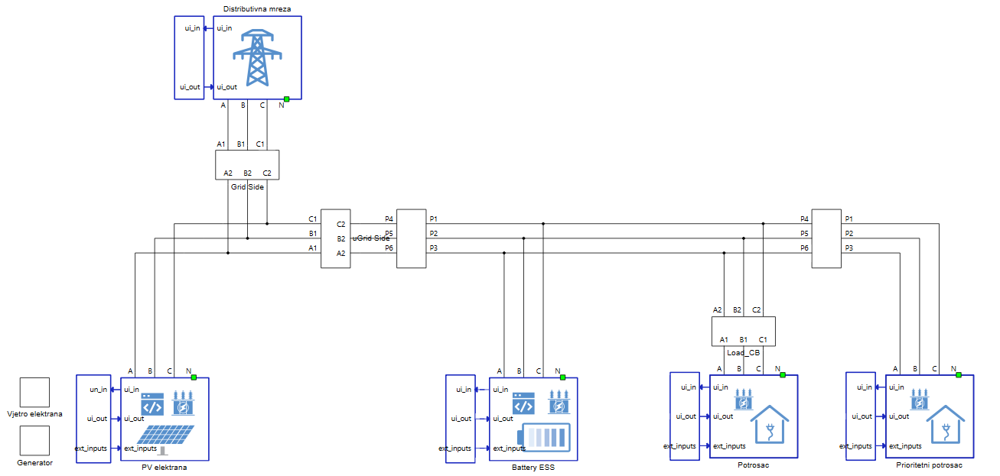

*`Distributivna mreža` feeds the microgrid through `Grid_Side`, the grid switch, and four loads and sources hang off the bus: `PV elektrana`, `Battery ESS`, `Potrosac` and `Prioritetni potrosac`. The `Vjetro elektrana` and `Generator` blocks on the left were left as empty stubs — wind and generator support existed in the block library and was deliberately not populated. Block labels are as they stand in the HIL project (Bosnian).*

_Model parameters were defined from real three-day measurements taken at the Faculty of Electrical Engineering in Sarajevo._

### Components and model parameters

| Component | Rating | Constraints in the model | Note |
| --- | --- | --- | --- |
| **BESS** | 5 kW, 72.8 Ah | SoC 30 – 90 %, ramp 0.5 p.u./s, ±1 p.u. charge/discharge | grid-forming in islanded mode |
| **PV plant** | 20 kW | ramp 1 p.u./s | generation profile by day |
| **Distribution grid** | 0.4 kV, 50 Hz | ToU tariff f(t) | slack bus in grid-connected mode |
| **Loads** | 43.51 kW | priority portion 5 kW | RLC model, MCB for disconnection |

The three time series the model is driven by:

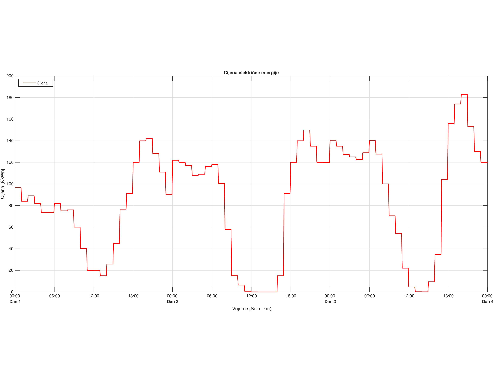

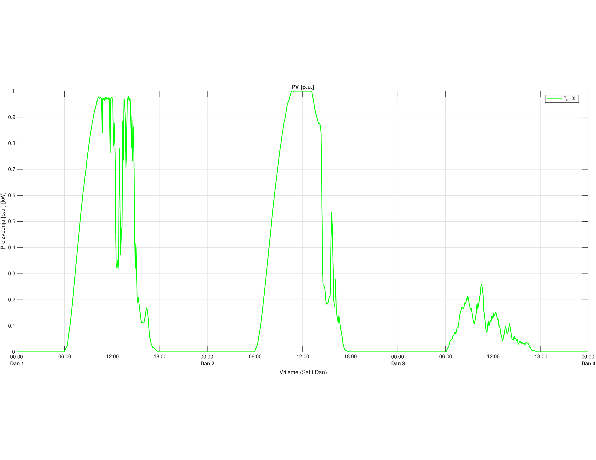

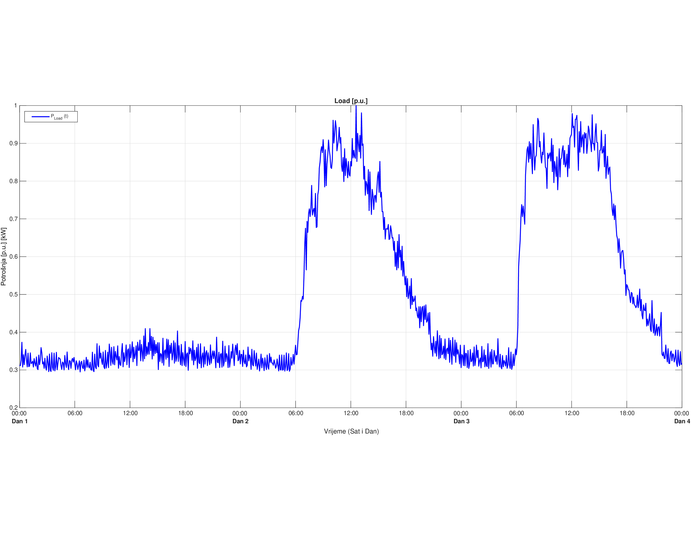

*Time-of-use tariff f(t), PV generation profile and load consumption profile. Plot labels are as exported for the thesis (Bosnian).*

### Tools and hardware

| Layer | Platform |
| --- | --- |
| Real-time simulation | Typhoon HIL 402, HIL Control Center, Schematic Editor, HIL SCADA |
| Controller | Raspberry Pi 5, control code in **C**, bare-metal communication |
| Communication | **ETH VE** (Ethernet Variable Exchange) — TCP/UDP with the lwIP library, ETH VE Setup / Send / Receive blocks |
| Modelling | Modular BESS / PV / Grid / Load blocks (Power Stage + Control Stage) |

Key values from the simulation:

$$
T_S = 20\ \mu s,\qquad T_1 = 1\ \text{ms},\qquad T_2 = 1\ \text{ms},\qquad T_C = T_1 + T_2 = 2\ \text{ms}
$$

The simulation step is fixed, the differential equations were discretised by the **bilinear (Tustin) transform**, and the DAE system was solved with a method suited to a model with switching topology (due to the switching elements).

### EMS: rule-based algorithm with eight rules

The controller collects the measured quantities each cycle (voltage, frequency, grid status, SoC, power of every component) and, according to its decision logic, sends the BESS power reference, the switch commands and the load-shedding signal.

| Rule | Condition | Action |
| --- | --- | --- |
| **Cond1** | distributor tariff < reference tariff | cheap energy → charge the BESS |
| **Cond2** | *P*difference = *P*loads − *P*sources < 0 | generation surplus → charge the BESS |
| **Cond3** | moving average price > threshold over the interval *N*/h | economic condition for charging |
| **Cond4** | *V*meas ∉ [0.9; 1.1]·*V*nom ∨ *f*meas ∉ [0.99; 1.01]·*f*nom | grid disconnected → **islanded** |
| **Cond5** | voltage and frequency within limits, grid connected | **reconnection** to the distribution grid |
| **Cond6** | grid disconnected | shed standard loads, keep the priority load |
| **Cond7** | *P*difference > *P*charge,max | curtail sources / disconnect part of the generation |
| **Cond8** | SoC[*n*] ≤ SoCmin | forced charging up to SoCrec (hysteresis) |

The critical condition (Cond8) takes priority over all other rules — the algorithm blocks discharging and force-charges the battery with hysteresis, and only after the SoC recovers does it return to the economic rules.

### HIL SCADA supervision interface

The compiled model runs in Typhoon HIL Control Center against a custom SCADA panel built for the task — analog and digital instruments, control switches, LED indicators and multi-channel scopes. It is not read-only: fixed model parameters can be changed mid-run, from voltage and frequency references to the state of the switching elements in the network.

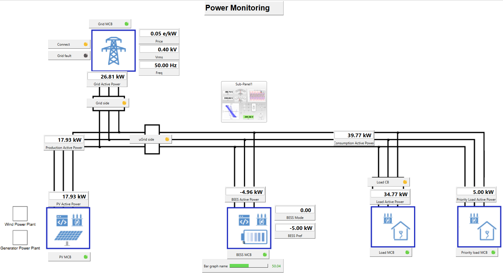

*The one-line view during a grid-connected run. Production of 17.93 kW is entirely PV, consumption of 39.77 kW splits into 34.77 kW standard plus the 5.00 kW priority portion, and the grid delivers 26.81 kW. The BESS holds −4.96 kW against a −5.00 kW reference — charging, which the balance confirms: 26.81 + 17.93 ≈ 39.77 + 4.96, the residual being display rounding. The tariff reads 0.05 e/kW, so the controller is in rule Cond1, buying the cheap window.*

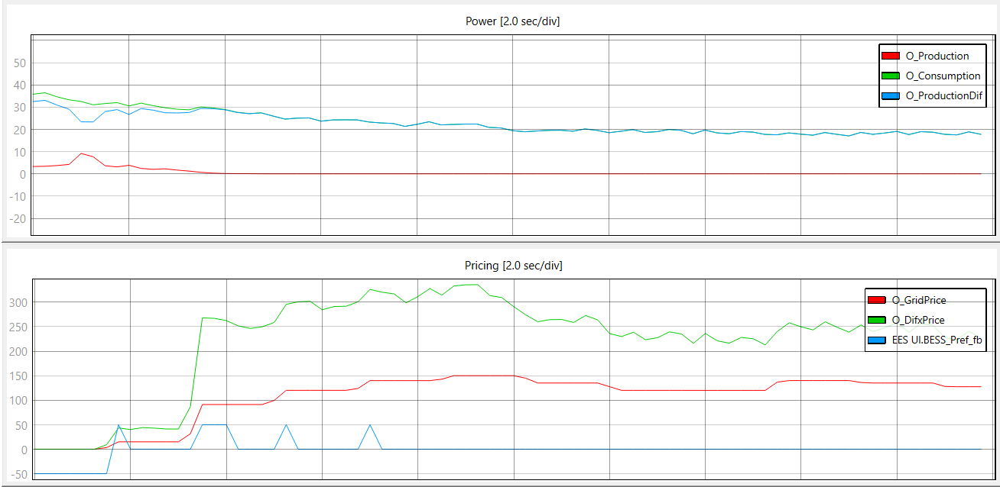

*The scope widgets at 2.0 s/div: production, consumption and their difference above, the grid price, the price difference the economic rules compare, and the BESS power reference the controller is moving below.*

### Test scenarios and results

**Grid-connected mode:**

- Tariff-based (ToU) operation with **Peak Clipping** and **Valley Filling** — the BESS charges on cheap energy and discharges expensive energy.
- Charging from the PV generation surplus (Cond2).
- "Eco" charging to the target SoC level: **80 %** in the fuller scenario, **60 %** in the more conservative one.

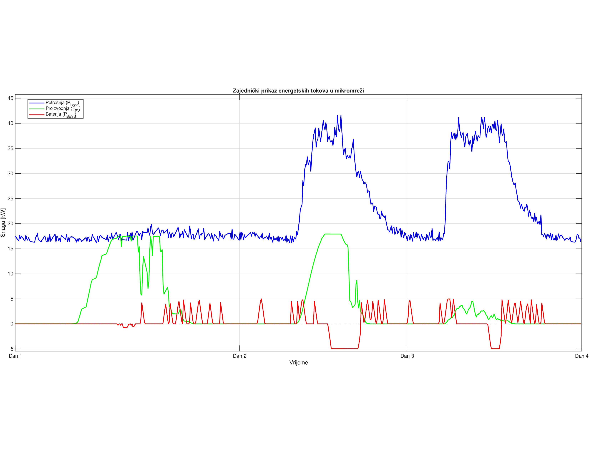

*Output power of all components in grid-connected operation. The BESS charges even while the building's consumption is high — a negative BESS power means energy accumulating in the system. That is rule Cond1 at work: the cheap tariff window is used for storage regardless of the instantaneous load profile.*

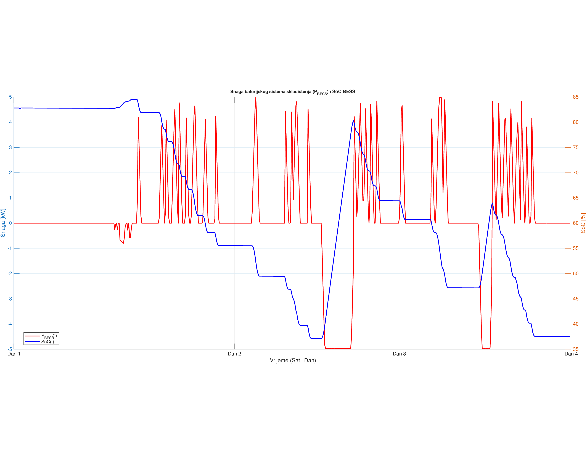

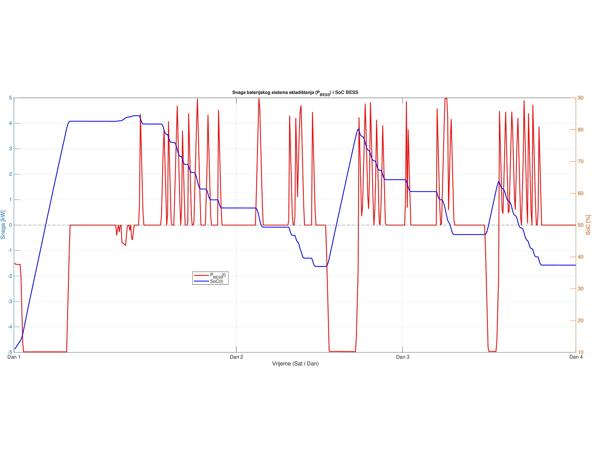

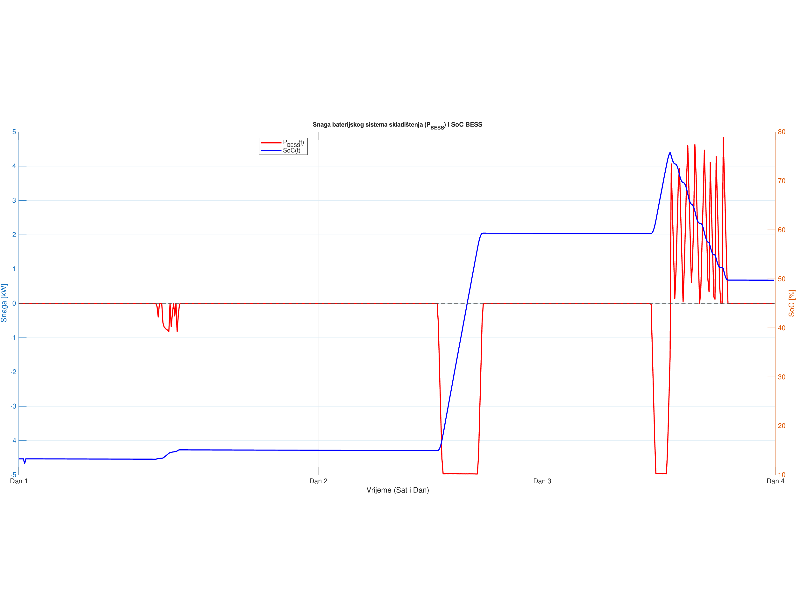

*BESS power against SoC. Charging from a PV surplus in the middle of the first day — the surplus goes to the battery instead of being exported back to the distributor (Cond2); then rule Cond8 charging to an 80 % target, and the same rule with **Eco mode** active, where the target is the more conservative 60 %.*

**Islanded mode:**

- A grid fault → the STS switch successfully isolates the microgrid at the PCC, and the BESS takes over grid forming.
- The algorithm triggers Cond6 and performs **load shedding**: standard loads are disconnected, the 5 kW priority portion stays supplied, with no risk of a complete blackout.
- **The voltage stayed within [0.9; 1.1]·Vnom and the frequency within [0.99; 1.01]·fnom** throughout the transient.

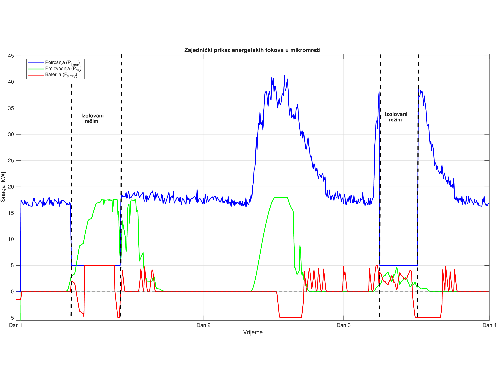

*The grid-fault transient. The digital trace is the Grid Fault signal marking the islanded windows; the fault itself was produced by disconnecting the microgrid from the distribution network by hand, to exercise the islanded rules. *P*Load falls sharply and settles at the 5 kW priority portion, while the BESS moves its operating point to cover the balance between consumption and PV generation.*

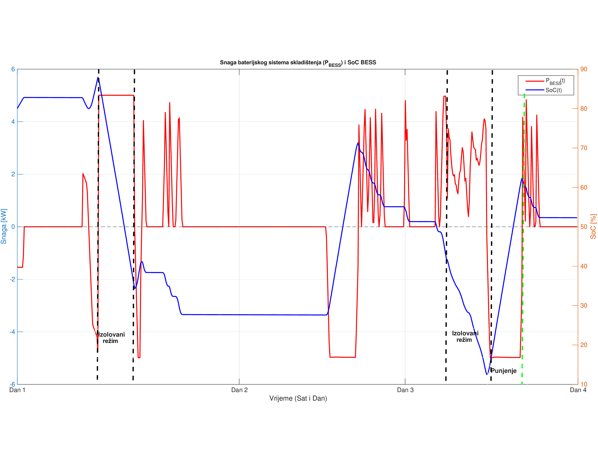

*PV surplus is routed into the battery, and where generation would overload both the battery and the priority load the algorithm disconnects the PV plant preventively, keeping voltage and frequency from climbing unchecked in the isolated system.*

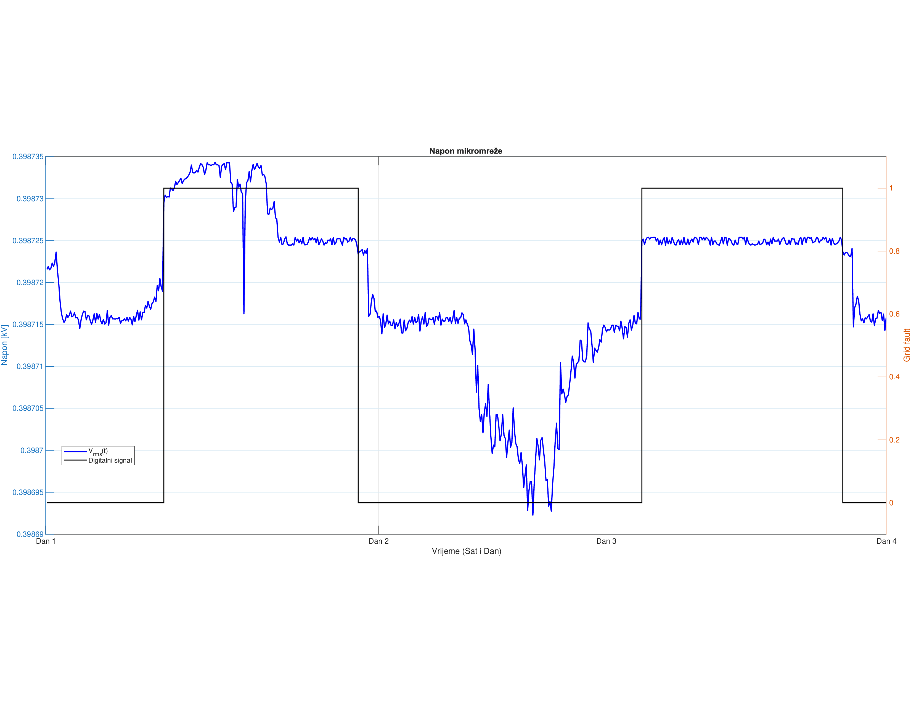

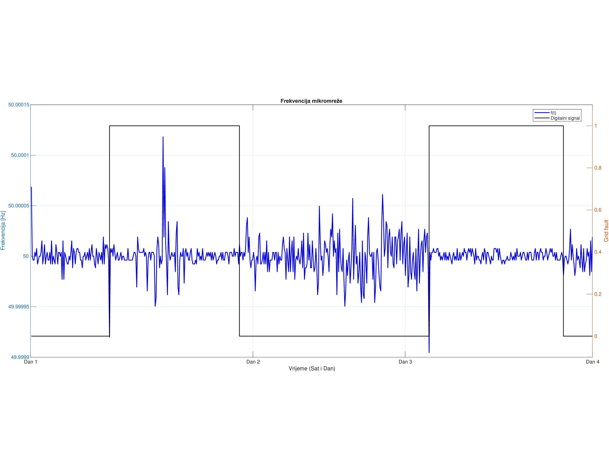

*Voltage and frequency across every transition. Both stay inside the required tolerance bands, with only minimal dynamic deviation during the switching events.*

**Reconnection:** the BESS moves smoothly from grid-forming to grid-following and returns to its primary function of optimising power flows by tariff.

!!! success "Main result"
    The real-time HIL simulation confirmed full consistency between the theoretically defined rules and the actual response of the model on the HIL 402, with ETH VE providing data exchange at minimal and predictable latency.

### Limitations (as stated in the thesis)

- The model relies on **lumped models** of the components, because the HIL platform's real-time constraints do not allow complex transients in electrical machines.
- The rule-based approach is efficient and predictable, but **does not learn or adapt** to a drastically changed topology without manual reconfiguration.
- Ethernet communication delays were neglected due to the high speed of the controller.

### Future work

More advanced control methods — **MPC** (Model Predictive Control) and artificial-intelligence-based algorithms — for higher energy efficiency and resilience to unforeseen disturbances.

!!! info "Materials"
    [Bachelor's thesis (PDF, 0.9 MB)](../attachments/microgrid-hil-thesis/microgrid-typhoon-hil-thesis.pdf){target=_blank} — *Modeliranje i simulacija sistema vođenja mikromreže u Typhoon HIL okruženju*, mentor v. prof. dr Senad Huseinbegović, July 2026.

    [Thesis LaTeX source (ZIP, 56 KB)](../attachments/microgrid-hil-thesis/microgrid-thesis-latex-source.zip){target=_blank} — five chapters, the appendix C source, the bibliography.

---

## Boost converter for charging an 18650 pack

**Course:** Power Converters · team: Anesa Bajramović, Emir Krdžalić · June 2026.

!!! abstract "In one sentence"
    A **boost DC/DC converter** (24 V → 54.6 V, 20 kHz) was designed to charge a **13S4P pack** of 52 × 18650 cells (48 V / 10 Ah) following a **CC-CV** profile — L and C calculated from the current-ripple specification, **state-space models of the ON and OFF states**, averaging and the transfer function, with the response verified in **MATLAB** (scripts `T1.m`–`T4.m`) and the complete charger re-simulated in **Typhoon HIL**.

### Battery pack

| Parameter | Value |
| --- | --- |
| Cell | **18650**, 2,500 mAh |
| Configuration | **13S4P** → 52 cells |
| Rated voltage / capacity | **48 V / 10 Ah** |
| Charging current (1C) | **10 A** |
| Charging profile | **CC-CV**, constant voltage up to **54.6 V** (13 × 4.2 V) |

### Boost stage design

$$
D = 1-\frac{V_{in}}{V_{out}} = 1-\frac{24}{54.6} = 0.5604
$$

| Quantity | Value | How it was obtained |
| --- | --- | --- |
| Switching frequency *f*s | **20 kHz** | requirement (outside the audible range) |
| Duty cycle *D* | **0.5604** | from the CCM voltage ratio |
| Inductor current ripple Δ*I*L | **1.1375 A** | ~20 % of the inductor current |
| Inductance *L* | **0.59 mH** | *L = V*in*D*/(*f*s·Δ*I*L) |
| Capacitance *C* | **1.4 mF** | from the allowed output voltage ripple |
| Equivalent load *R* | **10.92 Ω** | *R = V*out²/*P*out |

### Model and simulation

1. **ON state** (switch closed): the inductor stores energy from the source, the diode blocks the output.
2. **OFF state** (switch open): the energy in *L* passes to the load through the diode.
3. **Averaged model** (average state-space) → linearisation around the operating point → **transfer function**, whose response to a duty-cycle change was simulated in MATLAB.
4. In MATLAB (`T1.m`–`T4.m`) the responses of inductor current and output voltage to a step of **Δ*D* = 0.05** were generated, checking the ripple amplitude and the time constant.

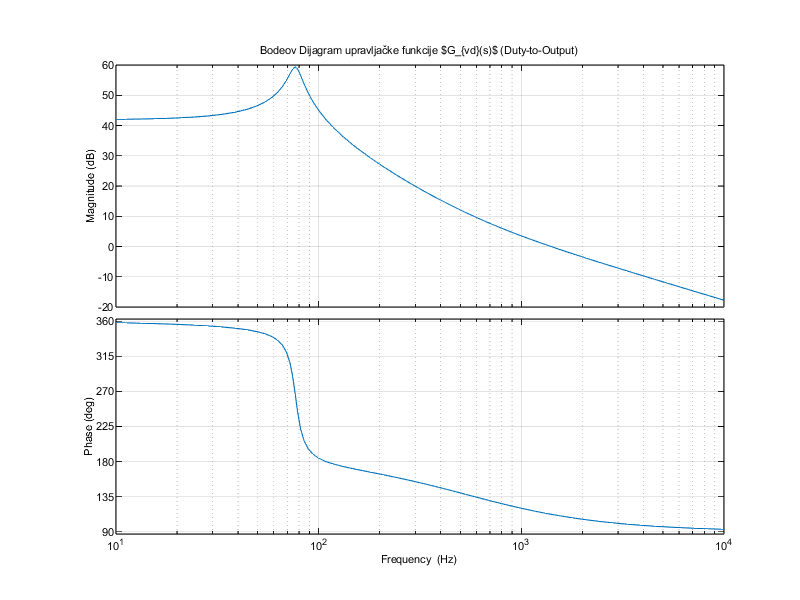

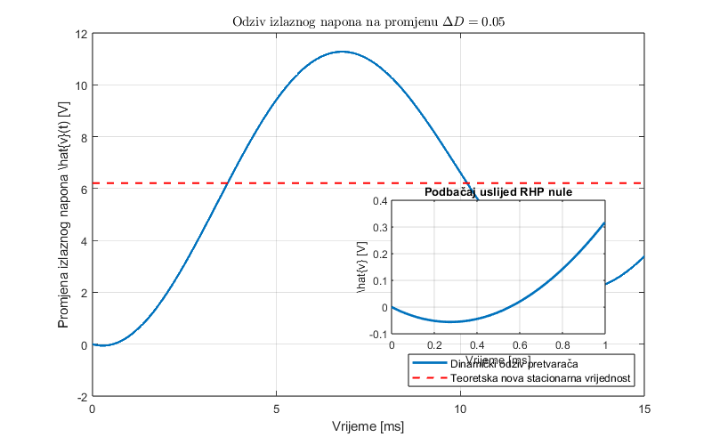

*Control-to-output Bode plot from `T1.m` — the resonant peak at the LC double pole, and phase falling through 180° toward 90° — and the response to a step of Δ*D* = 0.05, where the output first moves away from the new setpoint because of the right-half-plane zero. Plot labels are as exported from MATLAB (Bosnian).*

### Closed-loop design

`T2.m` and `T3.m` close the loop around those same models: a **voltage PI regulator** for the constant-voltage phase and a **current PI regulator** for the constant-current phase. The voltage loop is bounded by the RHP zero — `T2.m` prints the resulting ceiling on the crossover frequency (*f*z/5) — while the current loop, which sees *Gid*(s), is stable on its own and is tuned straight to the target crossover.

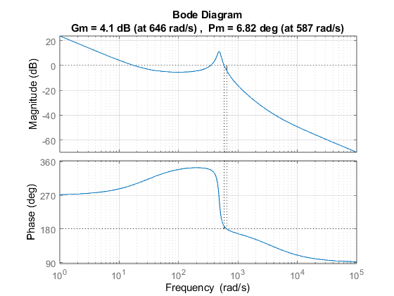

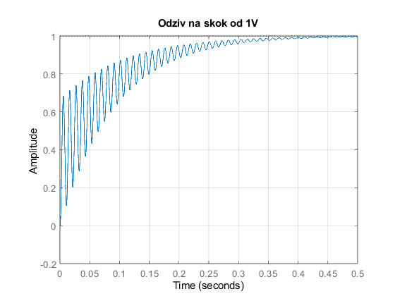

*Open voltage loop with the PI regulator (`T2.m`), and the closed-loop response to a 1 V reference step.*

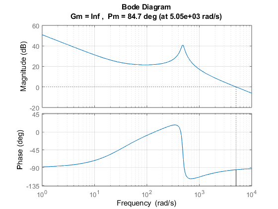

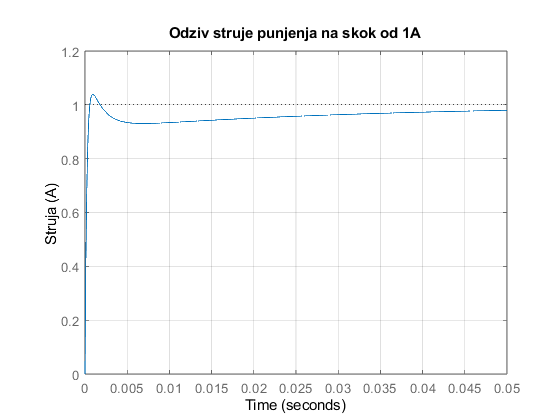

*Open current loop with the PI regulator (`T3.m`), and the closed-loop response to a 1 A reference step.*

### Typhoon HIL verification

The converter, both regulators and the pack were assembled into a single **Typhoon HIL** model and run through a full charge, observed from the SCADA panel.

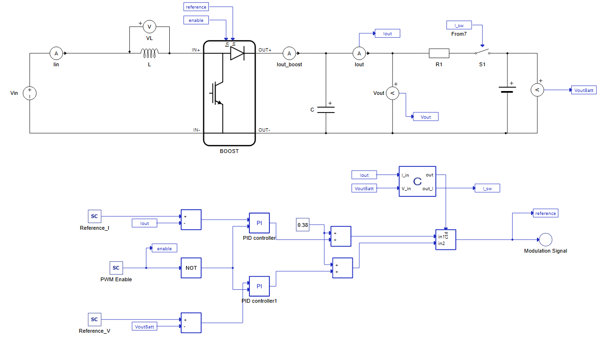

*Boost stage (inductor, switch, diode, output capacitor), the two PI regulators feeding the modulation signal.*

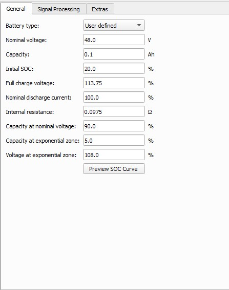

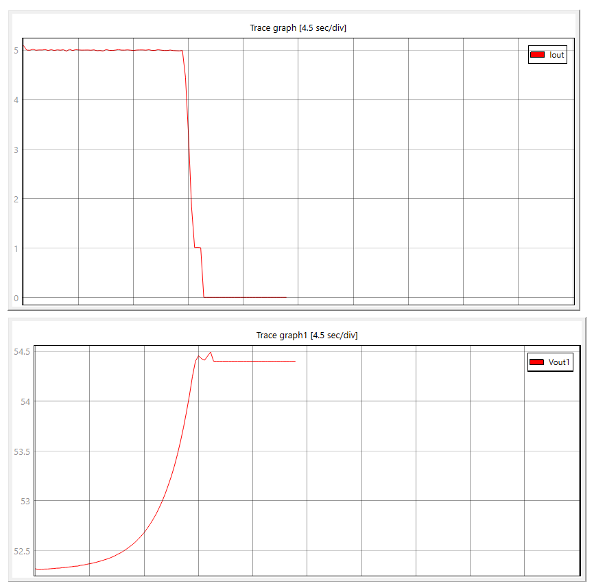

*User-defined battery model in Typhoon HIL, and the SCADA trace of charging current against battery voltage during the run.*

!!! info "Artifacts"
    [Term paper (PDF, 0.6 MB)](../attachments/boost-converter/boost-charging-term-paper.pdf){target=_blank}

    [MATLAB scripts + paper source (ZIP, 27 KB)](../attachments/boost-converter/boost-matlab-and-latex-source.zip){target=_blank} — `T1.m`–`T4.m`, the `T5.tse` model and the paper's `main.tex`.
