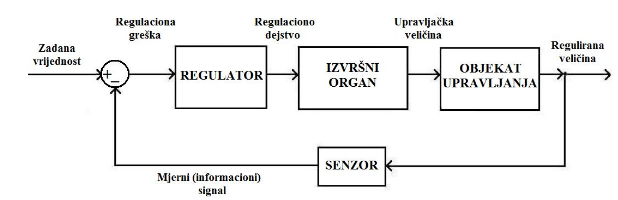
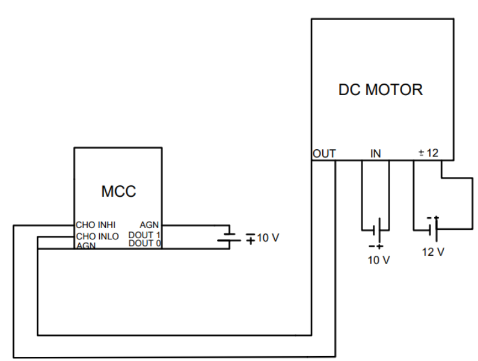
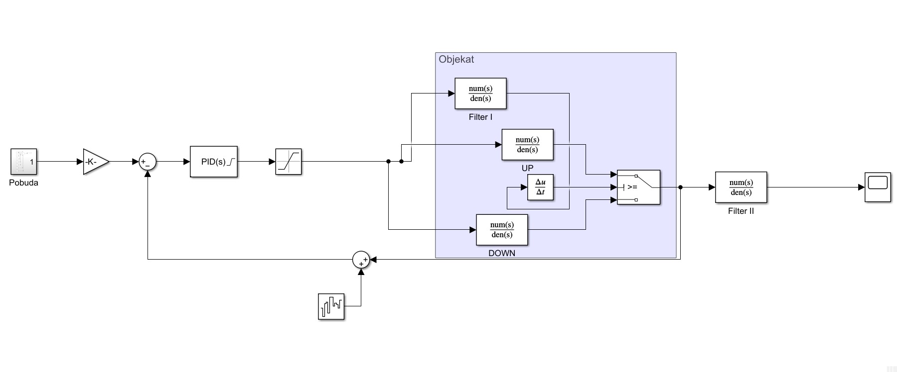
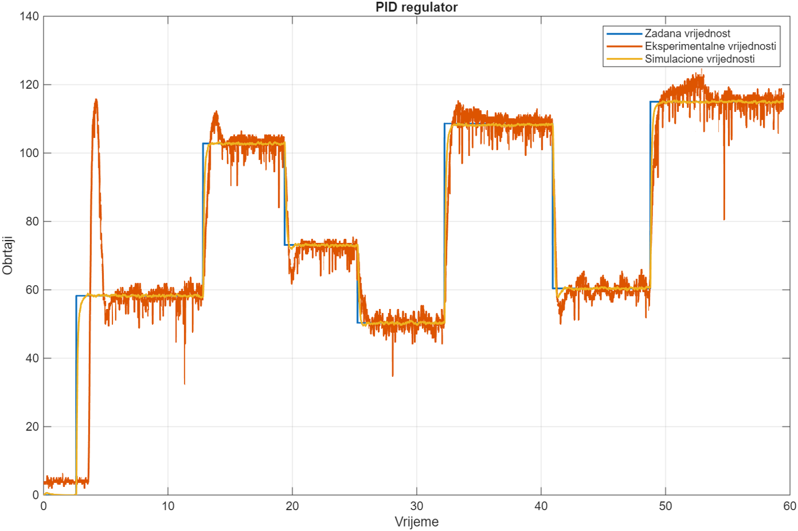
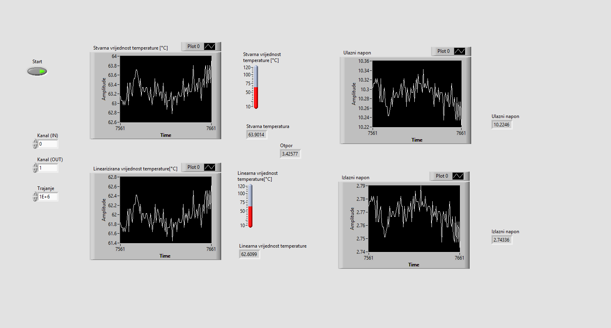
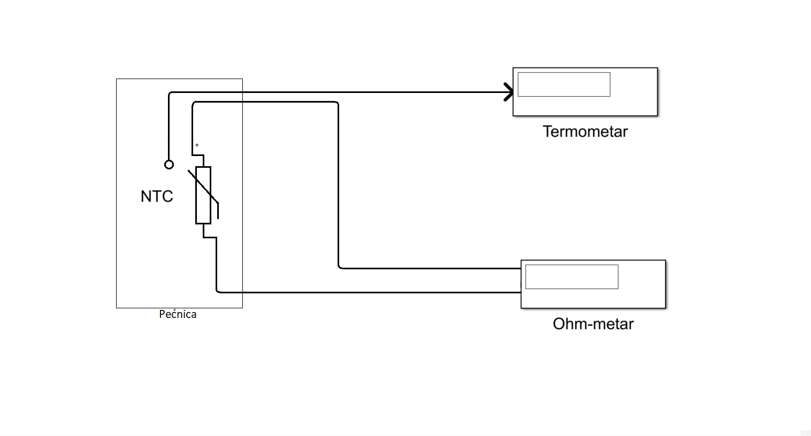
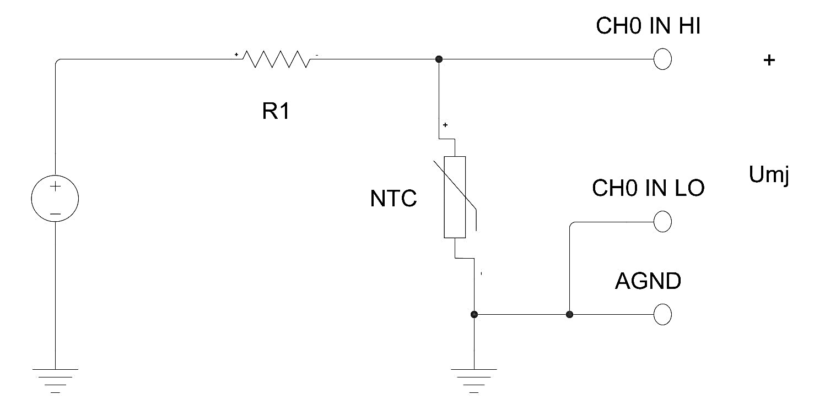

# Obrada Signala & Simulacije

Mjerenje, linearnizacija senzorskih signala, identifikacija sistema i PID regulacija — od laboratorije (**MCC** kartica, **LabVIEW**, **MATLAB/Simulink**) do eksperimentalne verifikacije.

---

## PID regulacija brzine DC motora

**Predmet:** Principi automatizacije i upravljanja (PAPU) · projektni zadatak 3 · 2026.

!!! abstract "U jednoj rečenici"
    Brzina DC motora mjerena **tahogeneratorom** preko **MCC ME-RedLab 1208FS** kartice regulisana je PID-om čiji su parametri dobiveni u **MATLAB PID Tuner**-u na osnovu identifikovanih prenosnih funkcija, a zatim implementirani u **Simulink** i na stvarnom postrojenju — uključujući **anti-windup** i zaštitu od šuma u povratnoj spregi.

### Mjereni sistem

| Element | Realizacija |
| --- | --- |
| Aktuator | DC motor **12 V**, upravljački signal **0–10 V** |
| Mjerenje | **tahogenerator** (napon proporcionalan obrtajima) |
| I/O | **MCC ME-RedLab 1208FS**, 12-bitni ADC/DAC |
| Softver | MATLAB (identifikacija, `pidtune`) + Simulink + eksperiment |





### Identifikacija

Identifikovane su **dvije odvojene** prenosne funkcije — motor se ponaša drugačije pri ubrzanju nego pri zaustavljanju (trenje i asimetrija gubitaka):

$$
G_{\text{vrti}}(s)=\frac{27{,}2541}{0{,}24\,s+1},\qquad
G_{\text{zaustavljanje}}(s)=\frac{26{,}964}{0{,}133\,s+1}
$$

### Parametri regulatora

PID je namešten u **PID Tuner**-u s prioritetom na **prvi preskok** odziva (maksimalno preblažavanje bez predugog vezivanja):

| Varijanta | K<sub>p</sub> | K<sub>i</sub> | K<sub>d</sub> |
| --- | --- | --- | --- |
| **PID Tuner (usvojena)** | **0,86253** | **6,8589** | **0,00074421** |
| Eksperimentalna 1 | 1,2938 | 27,4356 | — |
| Eksperimentalna 2 | 2,5876 | 5,007 | — |

U Simulink modelu dodani su:

- **saturacija + anti-windup** na izlazu regulatora (inače integral „nabubri" dok motor ne može dalje);
- **Switch + Derivative** grana koja razdvaja odziv po smjeru obrtanja (zbog različitih τ za vrti/zaustavljanje);
- filter za **šum tahogeneratora** u povratnoj spregi (D-član ga direktno pojačava).



### Rezultat: simulacija vs. eksperiment


*Usporedba odziva simuliranog modela i stvarnog postrojenja.*

!!! warning "Šta model ne pokriva"
    Pri **nižim obrtajima** javljaju se oscilacije i **mrtva zona** uslijed trenja — linearni model prvog reda to ne opisuje. Zato je eksperimentalni odziv sporiji i „nazubljeniji" od simuliranog; za puno korektnije vođenje potreban je model s kompensacijom trenja (ili dvostepeni regulator).

---

## Linearnizacija NTC termistora i obrada signala u LabVIEW-u

**Predmet:** Principi automatizacije i upravljanja (PAPU) · zadatak 1 · 2026.

### Problem

NTC termistor ima **eksponencijalnu** R(T) karakteristiku, pa napon na njemu nije proporcionalan temperaturi. Traži se otpornik **R1** u naponskom razdjelniku koji karakteristiku čini **najlinearnijom** u radnom opsegu.

### Metod

1. Mjerenje otpora u uzlaznom i silaznom smjeru temperaturnog opsega **31 – 142 °C** (histereza mjerenja je zabilježena).
2. Model napona na NTC-u: \(V_{\text{NTC}} = V\cdot R/(R+R_1)\).
3. Linearna aproksimacija (metoda najmanjih kvadrata) i **optimizacija R1 minimizacijom zbira kvadrata grešaka** u MATLAB-u:

```matlab
V  = 10;  R1 = 1.19e3;
vNTC = V .* R ./ (R + R1);
lin  = -0.0579 .* T + 7.2807;          % linearna aproksimacija
sse  = @(R1) sum( (V.*R./(R+R1) - lin).^2 );
R1opt = fminsearch(sse, 1e3);          % → 1,19 kΩ
```

Rezultat je linearna veza **V<sub>linear</sub> = −0,0959·T + 14,0389** (drugi set mjerenja: y = −0,0579·T + 7,2807 pri R1 = 1,19 kΩ i napajanju 10 V), a odstupanje od prave se kvantifikuje u tabelama i grafički.





### LabVIEW implementacija

Obrada signala i automatsko snimanje serija podataka rađeni su u **LabVIEW**-u (projektat `LV5.lvproj`):

| Datoteka | Uloga |
| --- | --- |
| `InputLV5.vi` | čitanje analognog ulaza sa MCC kartice |
| `Zad4.vi` | glavni VI: konverzija napona → temperatura, prikaz, grananje |
| `pomocni.vi` | pomoćna kalkulacija (R↔T, linearna aproksimacija) |
| `*.lvm` | snimljene serije mjerenja (ulaz za MATLAB obradu) |



### Šta sam naučio

- Linearnizacija je **kompromis opsega i tačnosti** — bolji R1 za sredinu opsega zna lošiju tačnost na krajevima.
- Uzlazni i silazni podaci se ne poklapaju (termička konstanta termistora), pa se linearnizacija mora raditi na jednom smjeru ili na proseku.
- LabVIEW za akviziciju + MATLAB za obradu je i dalje najbrži put od senzora do rezultata.

---

## Dokumentacija i kod

| Artefakt | Lokacija |
| --- | --- |
| PAPU zadatak 1 (`lin.m`, `LV5.lvproj`, `.lvm` mjerenja, PDF) | `Data/PAPU p1/` |
| PAPU zadatak 3 (Simulink model, PID parametri, PDF) | `Data/PAPU_Projekat3/` |
