# PLC & Automation

Design and programming of industrial control systems: a **Schneider** PLC + variable-frequency drive + **HMI**, and **two-position (on/off) control** implemented on a programmable relay.

---

## Design of the power supply and control side of a speed-control plant for an induction motor

**Course:** Industrial Automation · supervisor: Assistant Professor Nedim Osmić, PhD · expert: Hujdur Muhidin · assistant: Tarik Pozderac · 2025/26.
**Team:** E. Krdžalić, S. Muratagić, A. Šabić · role: programming the PLC–drive communication and the HMI visualisation

!!! abstract "In one sentence"
    A complete plant — **TM200CE24T** PLC, **ATV12H055M2** variable-frequency drive and **HMISTU855** touch HMI — was designed from the wiring diagram and cost estimate through to Modbus communication, drive function blocks and a multi-screen HMI project with user groups and passwords.

### Problem

Speed control of an induction motor is usually done with a variable-frequency drive, but the drive alone is not a system: the whole supply chain has to be defined (protection, isolation, E-STOP), along with communication between the PLC and the drive, and an operator visualisation with a hierarchy of access rights. The task was to design **the entire chain**: wiring diagram → hardware with cost estimate → PLC logic → Modbus → HMI.

### Wiring diagram

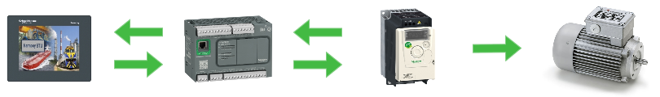

The supply side runs from the main switch and fuses to the **ATV12** drive and from there through a **CA3SK20BD** contactor to the induction motor; the control side is fed from a 24 V DC supply protected by an **RCD (300 mA)**.

| Component | Type / model | Role |
| --- | --- | --- |
| PLC | **Schneider TM200CE24T** (Modicon M221) | main control unit, Machine Expert Basic |
| Variable-frequency drive | **Schneider ATV12H055M2** (1.5 kW / 230 V) | speed control, **U/f = const** method |
| HMI | **Schneider HMISTU855**, 5.7" touch | visualisation and control, Vijeo Designer |
| Communication | **RJ45 / Modbus** (RS-485 serial port on the drive) | references and commands from PLC to ATV12 |
| Main contactor | **CA3SK20BD** | motor connection, driven from a PLC output |
| Motor protection | **RSL1PRBU** thermal overload relay | overload protection |
| E-STOP | **Harmony XB5** (mushroom head) | emergency stop, hardwired circuit |
| Protection | fuses **AC 10 A / AC 4 A / DC 2 A**, RCD 300 mA | short circuit and electric shock |
| Power supply | 24 V DC | control circuit of the PLC, HMI and drive |

<div class="gallery gallery--square" markdown="1">

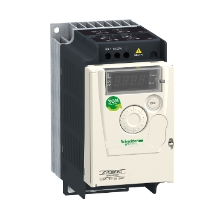

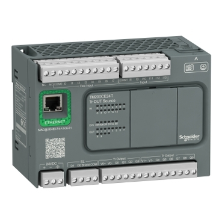

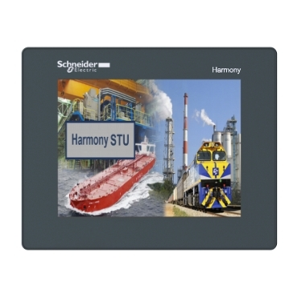

</div>

*ATV12H055M2 — U/f curve and Modbus address; TM200CE24T — 24 I/O points, built-in Modbus port; HMISTU855 — 5.7" resistive touch screen.*

### Cost estimate (total KM 2,824.10)

| Item | Amount (KM) |
| --- | --- |
| HMI HMISTU855 | 1,575.37 |
| PLC TM200CE24T | 604.55 |
| Drive ATV12H055M2 | 460.30 |
| Contactor CA3SK20BD | 70.31 |
| Thermal relay RSL1PRBU | 48.88 |
| RCD 300 mA | 41.10 |
| Harmony XB5 (E-STOP) | 17.59 |
| Cable and sundries | 6.00 |

### PLC side — Machine Expert Basic

Communication with the drive goes through the **ATV drive function blocks**, which hide the Modbus registers behind an API with an enable/execute handshake:

| Block | Task |
| --- | --- |
| `MC_Power_ATV` | enabling drive power |
| `MC_Jog_ATV` | manual jogging from the HMI |
| `MC_MoveVel_ATV` | motion at the commanded velocity (main command) |
| `MC_Stop_ATV` | controlled stop (ramp) |
| `MC_ReadStatus_ATV` | status bits (got, error, busy) |
| `MC_ReadMotionState_ATV` | drive state for the HMI indicators |
| `MC_Reset_ATV` | reset a drive fault |

```iecst
(* Main command: speed reference from the HMI, direction selected by a flag *)
MC_MoveVel_ATV(
    Axis       := ATV12,
    Execute    := hmi_Start AND NOT hmi_Stop AND NOT estop,
    Velocity   := hmi_ZadanaBrzina,          (* rpm, limited on the HMI side *)
    Direction  := hmi_SmjerCW,               (* TRUE = CW, FALSE = CCW *)
    Profile    := ATVFwd_Vel
);

(* Feedback for the HMI and the safety circuit *)
MC_ReadStatus_ATV(Axis := ATV12, Enable := TRUE);
hmi_Rad := MC_ReadStatus_ATV.IsMoving;
hmi_Greska := MC_ReadStatus_ATV.Error;
```

### HMI — Vijeo Designer

| Screen | Contents |
| --- | --- |
| **Main screen** | commanded and actual speed, START/STOP, CW/CCW direction selection, speed trend |
| **500 RPM / 1500 RPM** | direct speed presets (one touch) |
| **Direction change** | CW/CCW with the current speed and running time displayed |
| **Login / Logout** | sign-in, automatic logout after **1 min** of inactivity |
| **Event history** | *Alarms & Events* log (viewable by Inspector and Admin) |
| **Settings** | Admin: language, disabling direction change, adding users |
| **Safety settings** | E-STOP status and speed limit |
| **Multilingual** | EN / BS, switched at runtime |

<div class="gallery" markdown="1">

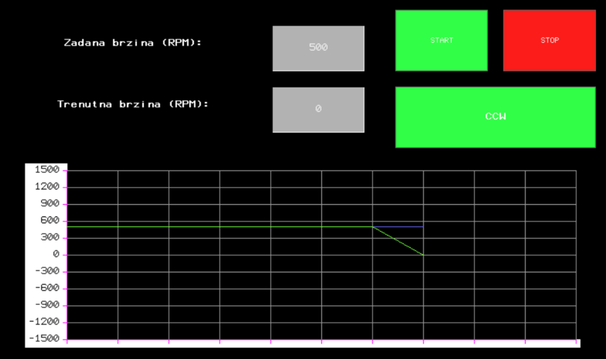


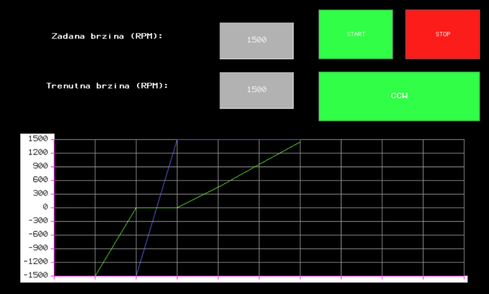

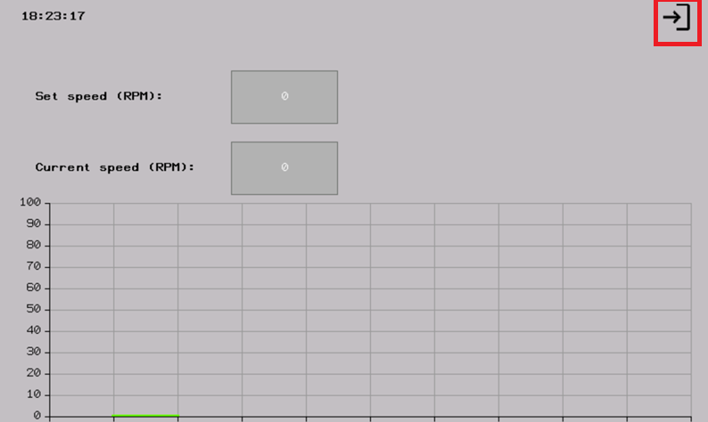

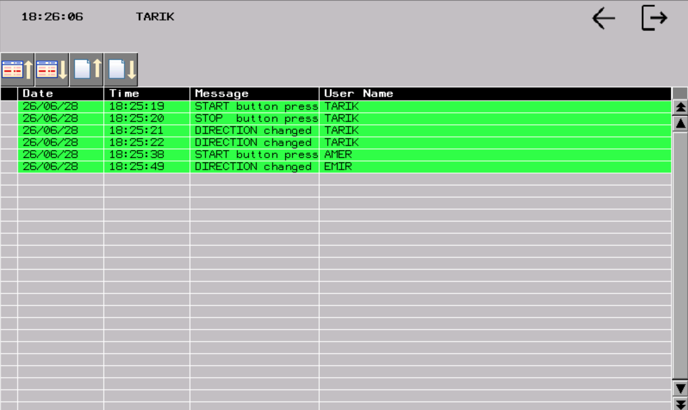

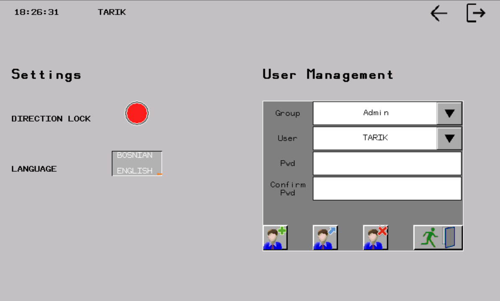

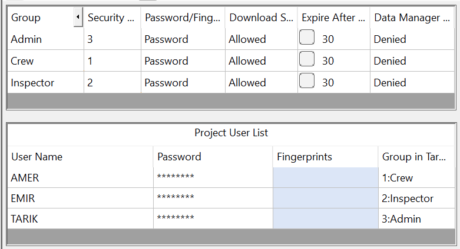

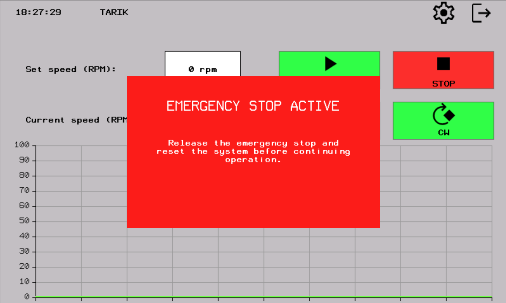

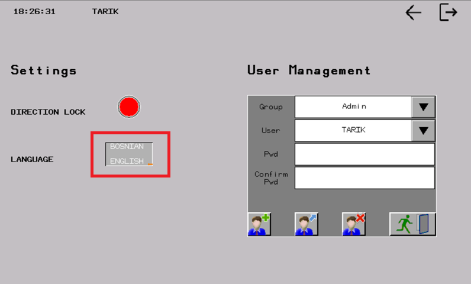

</div>

*Ten HMI screens: the main screen shows commanded vs. actual speed with START/STOP and direction selection; the remaining screens cover the speed presets, direction change, login, event log, settings, safety settings, emergency stop and runtime language switching.*

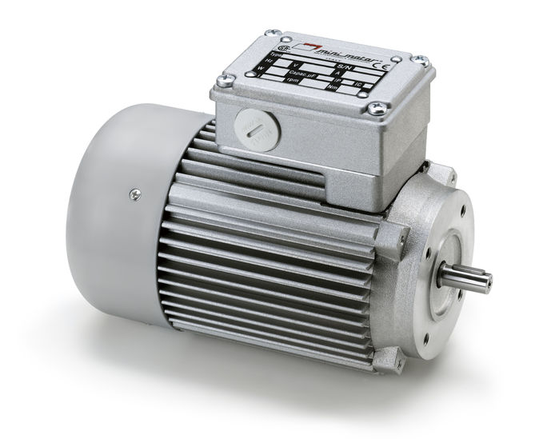
*Induction motor driven through the ATV12 (the physical part of the plant).*

#### Access-rights hierarchy

| Group | Start | Change speed | Change direction | Settings / users | History |
| --- | :-: | :-: | :-: | :-: | :-: |
| **Not signed in** | ✔ | ✘ | ✘ | ✘ | ✘ |
| **Crew** | ✔ | ✔ | ✘ | ✘ | ✘ |
| **Inspector** | ✔ | ✔ | ✔ | ✘ | ✔ |
| **Admin** | ✔ | ✔ | ✔ | ✔ | ✔ |

The design was justified verbally by referencing **NUREG-0700** (control room) and the **Rockwell Automation Guide to Effective Machine Control**, together with self-criticism: *the STOP button stayed permanently red even when the machine was stopped, which contradicts the recommendation that colour should reflect the current state.*

### My contribution (17 h, from the activity log)

| Activity | Hours |
| --- | :-: |
| Learning the Modbus protocol and ATV12 registers | 4 |
| Drive configuration and PLC ↔ ATV12 communication | 4 |
| Reconfiguration after the first failed test | 3 |
| Testing the first version of the program | 3 |
| Testing the final version | 2 |
| Drawing the wiring diagram | 1 |

### What I learned

- Reading the Modbus registers is not enough — the **bit order and the refresh cycle** of the drive block decide whether a command works at all.
- The first configuration **did not work**; only reconfiguring (address, baud, timeout) solved it — serial-link diagnostics cost more time than the programming itself.
- An HMI without an access-rights hierarchy is not an industrial solution, it is a demo.

---

## Two-position temperature control on a programmable relay (Eaton easy512)

**Course:** Principles of Automation and Control (PAPU) · assignment 2 · 2026.

!!! abstract "In one sentence"
    A temperature chamber (220 V lamp as heater, NTC sensor) was controlled by a **two-position on/off algorithm with hysteresis** on an **Eaton easy512-DC-RC** relay — first by identifying the thermal system from measured response, then by designing the comparator in **EASY-SOFT ladder logic** and verifying it in a **Simulink** model.

### Setup

| Part | Implementation |
| --- | --- |
| Controller | **Eaton easy512-DC-RC**, 24 V DC, EASY-SOFT |
| Input signal | **NTC 10 kΩ @ 20 °C** (540 Ω @ 120 °C) on analogue input **I7** |
| Output actuator | **Q1** → relay → **220 V lamp** (heater) |
| Analogue front end | bridge with a **10 V** supply, 12-bit ADC of the MCC card |
| Target temperature | **46 ± 1.5 °C**, in practice shifted to **48.5 ± 2.5 °C** to use the more linear part of the NTC curve |

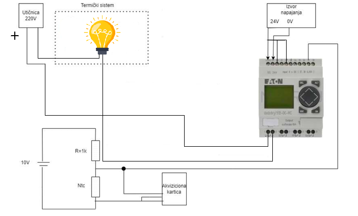
*Actual wiring on the easy512-DC-RC: analogue input I7 (NTC) and output Q1 to the 220 V heater.*

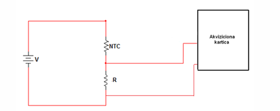
*Voltage divider with the NTC on a 10 V supply — the output goes to the 12-bit ADC.*

The NTC resistance is calculated from the measured output voltage as

$$
R_n=\frac{1.64}{10-V_{out}}\cdot V_{out},\qquad
T={76.716\,e^{-1.6759\,R_n}}+{79.481\,e^{-0.194\,R_n}}
$$

### System identification from measured response

From the step response of heating and cooling, a **first-order system with dead time** was modelled in both directions:

| Mode | Time constant τ | Gain K |
| --- | --- | --- |
| Heating (Q1 = 1) | **115.2089 s** | **+0.2786** |
| Cooling (Q1 = 0) | **151.3189 s** | **−0.2542** |

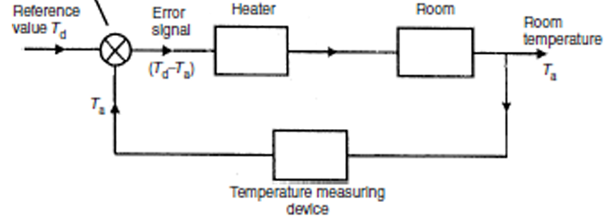

### Implementation in EASY-SOFT

The controller is written as a **ladder program** in the EASY-SOFT environment: comparing the measured temperature against the upper and lower hysteresis limits (analogue comparator) drives output Q1 directly.

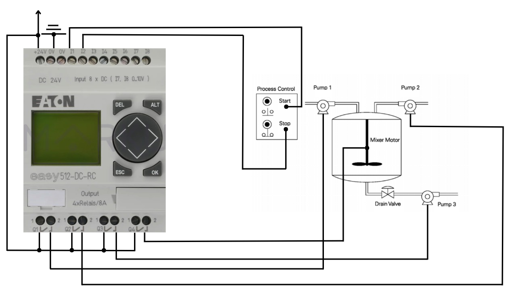

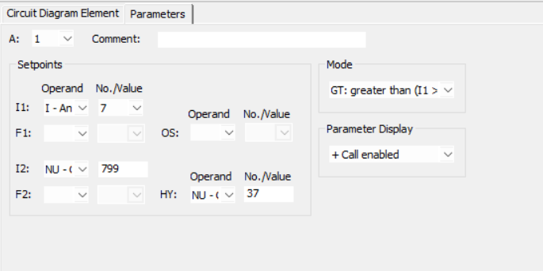
*Comparator settings — the width of the hysteresis band determines the number of switchings.*

In the **Simulink** model the first-order system was implemented with an integrator and the controller with a classic **Relay** block (hysteresis), which makes the number of switchings and the oscillation amplitude directly measurable:

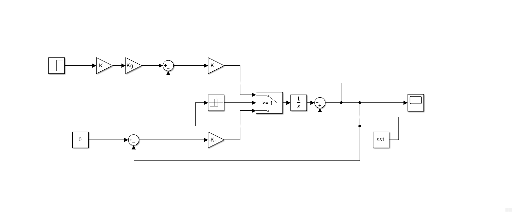

### Result and trade-off

Larger hysteresis → **fewer heater switchings** (longer relay life) but **larger temperature ripple**; smaller hysteresis → more accurate temperature but rapid wear of the output relay. The chosen value kept the temperature inside the required interval with an acceptable number of cycles.

!!! warning "Inconsistency found in the report"
    The report text claims the system **cools faster** than it heats, but the measured constants say the opposite: τ<sub>cooling</sub> = 151.3 s > τ<sub>heating</sub> = 115.2 s. The correct interpretation is that **heating dominates** (a stronger source than the losses), so the system cools more slowly.

### Materials

`Data/PAPU P2/` — EASY-SOFT project (ladder logic), PDF report, Simulink model, `.lvm` measurement recordings.

---

## Documentation and code

| Artefact | Location |
| --- | --- |
| IA term paper (PDF), wiring diagram, HMI project | `Data/IA_Projekat_Krdzalic_Muratagic_Sabic/` |
| PAPU assignment 2 (EASY-SOFT, Simulink, report) | `Data/PAPU P2/` |
| Activity log and cost estimate | attached to the IA paper |
